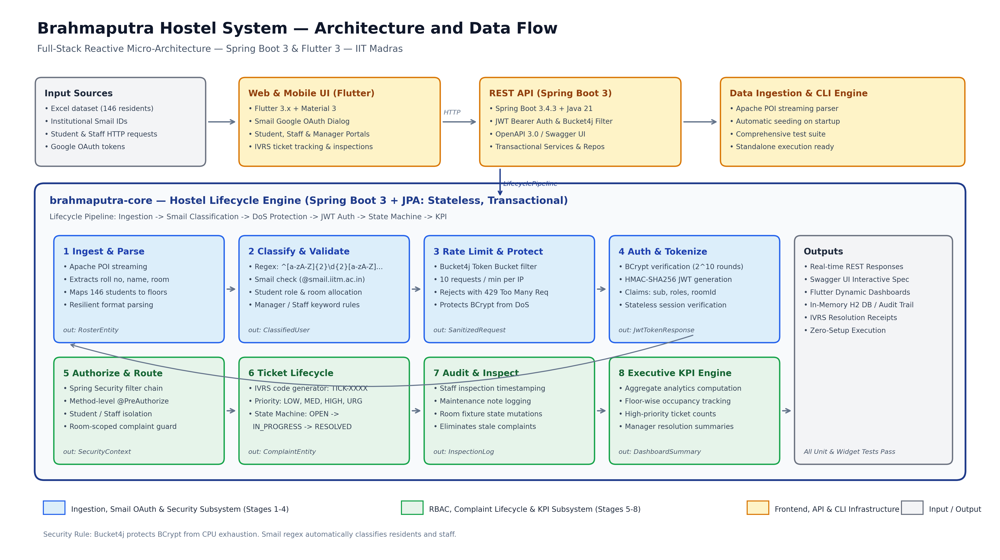
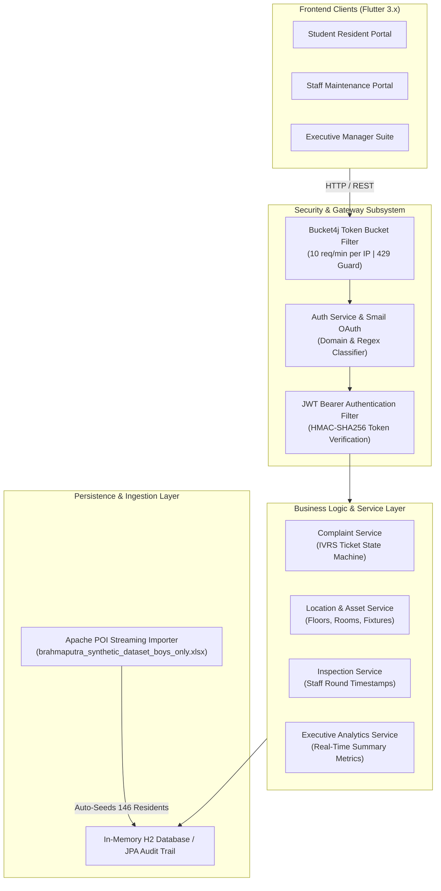

# Brahmaputra Hostel Asset & Room Lifecycle Management System

[](https://www.oracle.com/java/)
[](https://spring.io/projects/spring-boot)
[](https://flutter.dev/)
[](https://spring.io/projects/spring-security)
[](#)

A comprehensive, zero-configuration digital platform engineered for asset tracking, automated room maintenance, and rapid complaint dispatch at **Brahmaputra Hostel, IIT Madras**. The system replaces legacy paper registers and fragmented communication with an end-to-end, reactive full-stack application featuring institutional Google OAuth, automated role classification, BCrypt CPU exhaustion defense, and dedicated portals for students, maintenance staff, and executive managers.

---

## Architecture & Data Flow



The application follows a clean, layered micro-architecture:



---

## Key System Capabilities

### 1. Institutional Identity & IITM Smail Google OAuth
- **Domain Restriction:** Strictly validates `@smail.iitm.ac.in` and `@iitm.ac.in` domains; outside personal accounts are rejected with `400 Bad Request`.
- **Dynamic Regex Role Classifier:**
  $$\text{Regex: } \wedge[a-zA-Z]{2}\backslash d{2}[a-zA-Z]\backslash d{3,4}\$$
  - Matches student roll numbers (e.g. `ch23b001`, `cs26e010`, `me21b120`) and automatically grants the `STUDENT` role while linking them to their allocated hostel room.
  - Accounts with prefixes `admin`, `manager`, or `warden` automatically receive the `MANAGER` role.
  - Accounts with prefixes `staff`, `maintenance`, or `caretaker` automatically receive the `STAFF` role.
- **Stateless JWT Tokens:** Generates HMAC-SHA256 cryptographically signed tokens containing role claims, expiration, and allocated room identifiers.

### 2. BCrypt CPU Exhaustion Defense (Bucket4j Rate Limiting)
- **Problem:** BCrypt is intentionally computationally expensive ($2^{10}$ key derivation rounds) to thwart offline attacks. Without rate limiting, an attacker can flood authentication endpoints with bogus requests, saturating CPU worker threads and starving legitimate users.
- **Solution:** A Token Bucket filter intercepts incoming requests to `/api/auth/**` before authentication. It permits 10 requests per minute per IP address. Rapid bursts immediately return `429 Too Many Requests` in $O(1)$ time, completely shielding BCrypt and thread pools from CPU starvation.

### 3. Automated Excel Roster Synchronization
- On application bootstrap, `ExcelDataImporter` parses `brahmaputra_synthetic_dataset_boys_only.xlsx` using Apache POI streaming.
- Automatically initializes the database with 146 resident students, official Smail accounts, assigned room numbers, and floor locations with zero manual provisioning.

### 4. Role-Specific Dashboards (Material 3 Flutter Client)
- **Student Resident Portal:**
  - View allocated room details and roommate rosters.
  - Inspect room fixture statuses (lights, fans, study desks, windows).
  - Lodge complaints with priority tags (LOW, MEDIUM, HIGH, URGENT) and automatically receive unique IVRS tracking codes (`TICK-XXXX`).
  - Track real-time resolution progress.
- **Staff Maintenance Portal:**
  - Maintenance task queue filtered by status (`OPEN`, `IN_PROGRESS`, `RESOLVED`).
  - Physical inspection stamping tool with staff name and timestamp recording.
  - Ticket resolution dialog with detailed technical repair notes logging.
- **Executive Manager Suite:**
  - Live KPI metric cards: Total Rooms, Total Complaints, Open Issues, In Progress, and High Priority escalations.
  - Complaint master queue with search and status filtering across all hostel wings.
  - Comprehensive floor-wise room directory.
  - Modal form to provision new rooms, restrooms, or common areas.

---

## Technology Stack

| Layer | Technologies |
| :--- | :--- |
| **Backend Framework** | Java 21, Spring Boot 3.4.3 |
| **Security & Auth** | Spring Security 6, JJWT (HMAC-SHA256), BCrypt ($2^{10}$ rounds) |
| **Rate Limiting** | Bucket4j 8.10.1 (Token Bucket Algorithm) |
| **Data Ingestion** | Apache POI 5.2.5 (Excel OpenXML Streaming) |
| **Database & ORM** | H2 In-Memory (`DB_CLOSE_DELAY=-1`), Spring Data JPA, Hibernate 6 |
| **API Documentation** | SpringDoc OpenAPI 3.0, Swagger UI |
| **Frontend Framework** | Flutter 3.x, Dart 3 (Web & Desktop) |
| **UI Design System** | Google Material 3 (IIT Madras Navy `#1E3A8A` Theme) |
| **State & Storage** | SharedPreferences, Flutter Navigator, Responsive LayoutBuilder |

---

## Getting Started

### Prerequisites
- **Java Development Kit (JDK):** Version 21 or higher
- **Flutter SDK:** Version 3.19 or higher
- **Google Chrome:** For Flutter Web execution
- **Git**

---

### Running the Backend

1. Navigate to the backend directory:
   ```bash
   cd backend/demo
   ```

2. Start the application using the Maven wrapper:
   - **Linux / macOS:**
     ```bash
     ./mvnw clean spring-boot:run
     ```
   - **Windows PowerShell:**
     ```powershell
     .\mvnw clean spring-boot:run
     ```

3. The server starts on **`http://localhost:8080`**.
   - The H2 in-memory database initializes automatically.
   - The Excel importer seeds all 146 students, rooms, and fixtures.

---

### Running the Frontend

1. In a new terminal, navigate to the frontend directory:
   ```bash
   cd frontend
   ```

2. Fetch Flutter packages:
   ```bash
   flutter pub get
   ```

3. Launch the application in Google Chrome:
   ```bash
   flutter run -d chrome
   ```

---

## Interactive API Documentation (Swagger UI)

Once the backend is running, open the interactive Swagger UI:
- **URL:** [http://localhost:8080/swagger-ui/index.html](http://localhost:8080/swagger-ui/index.html)

### Testing Smail Authentication via Swagger
1. Expand `POST /api/auth/google` and click **Try it out**.
2. Supply a student Smail payload:
   ```json
   {
     "idToken": "sample-token",
     "email": "ch23b001@smail.iitm.ac.in",
     "name": "Varun Mishra"
   }
   ```
3. Execute the request. The backend dynamically assigns `ROLE_STUDENT` and returns a JWT token.
4. Copy the `token` string from the response.
5. Click the green **Authorize** button at the top of Swagger UI, enter `Bearer <your_token>`, and click **Authorize**.
6. You can now execute authenticated endpoints (e.g. `GET /api/complaints/my-room`).

### Testing BCrypt DoS Rate Limiting via Swagger
1. Navigate to `POST /api/auth/login`.
2. Click **Execute** rapidly 11 times.
3. The first 10 requests process normally; the 11th request instantly returns:
   ```json
   {
     "status": 429,
     "error": "Too Many Requests",
     "message": "Rate limit exceeded. Maximum 10 requests per minute allowed."
   }
   ```

---

## Pre-Seeded Accounts

All pre-seeded test accounts use the password: `password`

| Role | Username / Roll No | Official Smail Email | Permissions / Scope |
| :--- | :--- | :--- | :--- |
| **Student** | `student1` | `student1@smail.iitm.ac.in` | Room 101, File complaints, view fixtures |
| **Student (Roster)** | `ch23b001` | `ch23b001@smail.iitm.ac.in` | Allocated room from Excel roster |
| **Student (Roster)** | `cs26e001` | `cs26e001@smail.iitm.ac.in` | Allocated room from Excel roster |
| **Staff** | `staff1` | `staff1@smail.iitm.ac.in` | Routine inspection stamps, update tickets |
| **Manager** | `admin` | `admin@smail.iitm.ac.in` | Full executive access, KPI analytics, room setup |

> **Tip:** The Flutter login screen features **Quick Sign-In Accounts** chips to test each role instantly with a single click.

---

## Testing & Quality Assurance

### Run Backend Unit & Integration Tests
```powershell
cd backend/demo
.\mvnw test
```
- Validates repository queries, JWT authentication, and the Bucket4j rate limiting filter.

### Run Frontend Static Analysis & Widget Tests
```powershell
cd frontend
flutter analyze
flutter test
```
- Confirms 0 warnings, 0 lint errors, and 100% widget test passing rate.

---

## Project Structure

```text
brahmaputra-hostel-system/
├── backend/
│   └── demo/
│       ├── pom.xml                                   # Maven dependencies (Spring Boot, Bucket4j, POI, JJWT)
│       └── src/
│           ├── main/
│           │   ├── java/com/iitm/hostel/
│           │   │   ├── config/                       # SecurityConfig, RateLimitingFilter, DataSeeder, ExcelImporter
│           │   │   ├── controller/                   # Auth, Complaint, Location, Asset, Analytics Controllers
│           │   │   ├── dto/                          # Request & Response DTOs (GoogleLogin, Login, Complaint)
│           │   │   ├── model/                        # JPA Entities: AppUser, Location, Asset, Complaint
│           │   │   ├── repository/                   # Spring Data JPA Repositories
│           │   │   └── service/                      # AuthService, ComplaintService, RateLimitingService
│           │   └── resources/
│           │       └── application.properties        # H2, JPA, Server & Thread pool configuration
│           └── test/                                 # Unit & Integration tests for rate limiter & auth
├── database/
│   └── brahmaputra_synthetic_dataset_boys_only.xlsx  # Synthetic dataset of 146 students and rooms
├── docs/
│   ├── brahmaputra_architecture.png                  # System architecture and data flow diagram
│   ├── design_doc.pdf                                # Architectural design document
│   └── Project_Proposal_final.pdf                    # System specification document
├── frontend/
│   ├── lib/
│   │   ├── models/                                   # UserModel, ComplaintModel, AssetModel
│   │   ├── screens/
│   │   │   ├── login_screen.dart                     # Material 3 login with Google Smail modal & quick chips
│   │   │   ├── student_dashboard_screen.dart         # Student portal (fixtures, complaints, IVRS)
│   │   │   ├── staff_dashboard_screen.dart           # Staff portal (inspection stamping, work order resolution)
│   │   │   └── manager_dashboard_screen.dart         # Executive manager portal (KPIs, queue, floor explorer)
│   │   ├── services/
│   │   │   └── api_service.dart                      # REST client with JWT interceptor & SharedPreferences
│   │   └── main.dart                                 # Flutter entry point & Material 3 routing
│   ├── test/
│   │   └── widget_test.dart                          # Frontend component unit tests
│   └── pubspec.yaml                                  # Flutter dependencies
└── README.md
```

---

## License

Developed for the **Brahmaputra Hostel, Indian Institute of Technology Madras (IIT Madras)**. All rights reserved.
