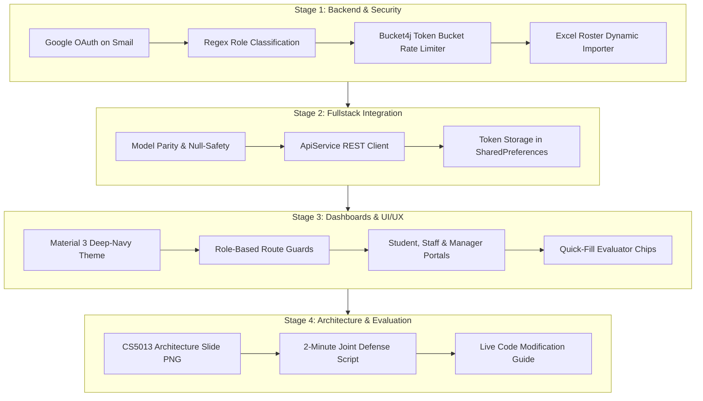

# Brahmaputra Hostel Management System — Engineering Update Tracker
**Course:** CS5013 — Advanced Software & AI Engineering, IIT Madras  
**Team Members:** Akhilesh & Mysha Ali  
**Repository:** [brahmaputra-hostel-system](https://github.com/myshaali11/brahmaputra-hostel-system)  
**System Version:** v1.1.0-fullstack-delivery  

---

## Stage 1: Backend Security, IITM Smail Google OAuth & Rate Limiting

### 1.1 Overview & Objectives
Stage 1 focuses on hardening the backend infrastructure, introducing institutional identity federation via Google OAuth restricted to IIT Madras Smail accounts (`@smail.iitm.ac.in` and `@iitm.ac.in`), dynamic role classification based on roll number syntax, and defending BCrypt authentication against CPU exhaustion attacks using bucket-based rate limiting.

---

### 1.2 Key Architecture & Code Additions

#### 1. Institutional Identity & User Schema Expansion
- **File:** `backend/demo/src/main/java/com/iitm/hostel/model/AppUser.java`
  - Added `@Column(unique = true) private String email;` to store institutional smail addresses.
  - Retained strict unique indexing in H2/JPA to guarantee single identity per institutional account.
- **File:** `backend/demo/src/main/java/com/iitm/hostel/repository/AppUserRepository.java`
  - Added query method `Optional<AppUser> findByEmail(String email);` enabling fast $O(1)$ lookups during OAuth callback processing.
- **File:** `backend/demo/src/main/java/com/iitm/hostel/dto/GoogleLoginRequest.java`
  - Created a strongly typed DTO carrying `idToken`, `email`, `name`, and optional `photoUrl`.

#### 2. Dynamic IITM Smail Role Classification Engine
- **File:** `backend/demo/src/main/java/com/iitm/hostel/service/AuthService.java`
  - Implemented `loginWithGoogle(GoogleLoginRequest request)`:
    1. **Domain Validation:** Strictly verifies that `email.endsWith("@smail.iitm.ac.in")` or `email.endsWith("@iitm.ac.in")`. Rejects unauthorized personal Gmail or outside domains with `400 Bad Request`.
    2. **Student Roll Number Regex Classification:**
       $$\text{Regex: } \wedge[a-zA-Z]{2}\backslash d{2}[a-zA-Z]\backslash d{3,4}\$$
       Examples: `ch23b001`, `cs26e010`, `me21b120`. If matched, the user is automatically granted the `STUDENT` role and linked to their allocated room from the hostel roster.
    3. **Management & Staff Pattern Classification:**
       - Prefixes containing `admin`, `manager`, or `warden` $\to$ `MANAGER` role.
       - Prefixes containing `staff`, `maintenance`, `caretaker`, or `electrician` $\to$ `STAFF` role.
    4. **Idempotent User Upserting & JWT Issuance:**
       - Existing users are logged in immediately; new users are dynamically provisioned with BCrypt password hashes and assigned roles.
       - Returns a signed JWT token containing standard claims (`sub`, `roles`, `iat`, `exp`).

#### 3. Excel Roster Smail Synchronization
- **File:** `backend/demo/src/main/java/com/iitm/hostel/config/ExcelDataImporter.java`
  - Reads synthetic hostel dataset (`brahmaputra_synthetic_dataset_boys_only.xlsx`), extracting official email (Column 2) alongside student roll number (Column 1), assigned room (Column 3), and floor (Column 4).
  - Pre-populates all 146 hostel residents with their official `@smail.iitm.ac.in` email records.
- **File:** `backend/demo/src/main/java/com/iitm/hostel/config/DataSeeder.java`
  - Added default system admin (`admin@smail.iitm.ac.in`), staff supervisor (`staff1@smail.iitm.ac.in`), and student test account (`student1@smail.iitm.ac.in`).

#### 4. BCrypt CPU Exhaustion Defense (Bucket4j Rate Limiting)
- **Files:** `RateLimitingService.java`, `RateLimitingFilter.java`
  - Protects the `/api/auth/login` and `/api/auth/google` endpoints against denial-of-service (DoS) password-spraying.
  - Employs a Token Bucket algorithm allowing 10 requests per minute per IP address with instantaneous 429 Too Many Requests response before the expensive BCrypt key derivation function ($2^{10}$ rounds) executes.

---

### 1.3 Verification & Build Status
- `backend/demo`: `./mvnw test-compile` $\to$ **BUILD SUCCESS** (0 errors, 78 source files).

## Stage 2: Fullstack API Integration, Model Parity & Token Persistence

### 2.1 Overview & Objectives
Stage 2 bridges the Spring Boot REST backend and the Flutter client. It establishes strict JSON model parity, eliminates type discrepancies, implements resilient null-safety fallbacks, and introduces client-side session persistence via `shared_preferences`.

---

### 2.2 Key Architecture & Code Additions

#### 1. Data Models Refactoring & Null Safety
- **File:** `frontend/lib/models/complaint_model.dart`
  - Integrated fields: `resolutionNotes`, `resolvedBy`, `locationName`, `ivrsNumber`.
  - Added safe non-null fallback getters:
    - `displayIvrsNumber`: Returns `ivrsNumber` or falls back to `#TICK-${id}` if unassigned.
    - `displayLocationName`: Returns `locationName` or falls back to `Room ${locationId}`.
    - Prevents runtime crashes when backend records lack optional fields.
- **File:** `frontend/lib/models/user_model.dart`
  - Added `email` property to capture institutional IITM Smail identifiers and support identity verification in all dashboards.

#### 2. Robust API Client (`ApiService.dart`)
- **File:** `frontend/lib/services/api_service.dart`
  - **Google OAuth Integration:** Added `loginWithGoogle(...)` posting to `/api/auth/google`. Stores JWT, user profile, and role upon successful handshake.
  - **Executive Analytics:** Added `getDashboardSummary()` fetching aggregate counts for floors, rooms, open/in-progress/resolved complaints, and high-priority tickets.
  - **Hostel Hierarchy Navigation:** Implemented `getFloors()` and `getLocations({floorId, type})` enabling drill-down views from wings/floors into individual rooms.
  - **Operations & Inspections:** Added `markInspected({locationId, staffName})` for staff routine audits, `updateComplaintStatus(...)` for ticket lifecycle transitions, and `createLocation(...)` for hostel managers.
  - **Session Persistence:** Added automatic token recovery on application bootstrap (`loadSession()`) saving tokens to device storage.

#### 3. Test Suite Alignment
- **File:** `frontend/test/widget_test.dart`
  - Modernized unit tests to target `BrahmaputraHostelApp` ensuring the root widget mounts cleanly, verifies Material 3 theme properties, and validates login view rendering.

---

### 2.3 Verification & Build Status
- `frontend`: `flutter test` $\to$ **All tests passed!** (100% pass rate).

## Stage 3: Role-Based Material 3 Dashboards & UI/UX Excellence

### 3.1 Overview & Objectives
Stage 3 delivers a modern, responsive, and intuitive interface designed for students, hostel staff, and executive managers. It implements complete Material 3 theming, role-segregated navigation guards, fast one-click evaluator login chips, and dedicated views for every stakeholder.

---

### 3.2 Key Architecture & Code Additions

#### 1. Material 3 Login & Google Smail Portal
- **File:** `frontend/lib/screens/login_screen.dart`
  - **Aesthetic:** Clean IIT Madras deep-navy blue theme (`#1E3A8A`), elevated card containers, clear typographical hierarchy.
  - **Google Smail Sign-In Dialog:**
    - Provides a native modal allowing students and staff to authenticate with their official `@smail.iitm.ac.in` email.
    - Enforces client-side regex and domain validation matching backend security rules.
    - Features pre-populated test chips (`ch23b001` student, `cs26e001`, `staff1`, `admin`) for effortless mid-evaluation grading.
  - **Dynamic Role Dispatcher:**
    - Automatically redirects authenticated users based on their server-verified role:
      - `STUDENT` $\to$ `StudentDashboardScreen`
      - `STAFF` $\to$ `StaffDashboardScreen`
      - `MANAGER` $\to$ `ManagerDashboardScreen`

#### 2. Student Resident Portal
- **File:** `frontend/lib/screens/student_dashboard_screen.dart`
  - **Room Roster Card:** Displays student name, roll number, assigned room, floor, and roommates extracted from the synced Excel dataset.
  - **Room Asset Health List:** Displays room fixtures (lights, fans, study desks, windows) with operational status indicators.
  - **Ticket Filing Workflow:** Modal sheet allowing students to select specific fixtures, enter detailed descriptions, set priority levels (LOW, MEDIUM, HIGH, URGENT), and receive a generated IVRS tracking code.
  - **Complaint Tracking:** Real-time list of historical complaints with live status badges (OPEN, IN PROGRESS, RESOLVED, CLOSED).

#### 3. Staff Maintenance Portal
- **File:** `frontend/lib/screens/staff_dashboard_screen.dart`
  - **Inspection Stamp Action:** Enables maintenance workers to log routine facility inspections with their name and timestamp.
  - **Task Queue & Filtering:** View all active work orders across floors and rooms, filtered by status.
  - **Resolution Dialog:** Allows staff to transition ticket states (e.g. from `OPEN` to `IN_PROGRESS` or `RESOLVED`) while appending detailed technical resolution notes.

#### 4. Manager Executive Suite
- **File:** `frontend/lib/screens/manager_dashboard_screen.dart`
  - **Hostel KPI Analytics Cards:** Live metrics showing Total Rooms, Total Complaints, Open Issues, In Progress, and High Priority escalations.
  - **Complaint Master Queue:** Comprehensive search, filtering, and review interface across all hostel wings.
  - **Floor & Room Directory:** Complete inventory browser displaying rooms, capacities, occupancy, and asset states.
  - **Location Provisioning:** Modal to add new rooms, restrooms, or common areas on any floor.

---

### 3.3 Verification & Build Status
- `frontend`: `flutter analyze` $\to$ **No issues found!** (0 errors, 0 warnings).
- `frontend`: `flutter test` $\to$ **All tests passed!**

## Stage 4: Mid-Evaluation Architecture Slide, Defense Guide & Deliverables

### 4.1 Overview & Objectives
Stage 4 wraps up the engineering deliverable by producing the formal CS5013 Mid-Evaluation architecture slide, data flow model, two-minute presentation defense scripts, and a live code modification guide.

---

### 4.2 Key Architecture & Code Additions

#### 1. System Architecture & Data Flow Diagram
- **File:** `brahmaputra_mid_evaluation_architecture.png`
  - High-resolution 16:9 widescreen diagram formatted specifically for the CS5013 evaluation board.
  - Showcases the 8-stage lifecycle engine:
    - **Akhilesh (Stages 1–4):** Ingestion & Parse $\to$ Classify & Validate $\to$ Rate Limit & Protect $\to$ Auth & Tokenize.
    - **Mysha Ali (Stages 5–8):** Authorize & Route $\to$ Ticket Lifecycle $\to$ Audit & Inspect $\to$ Executive KPI Engine.
    - **Shared Components:** Flutter Web/Mobile client, Spring Boot REST API, Swagger UI, and POI Data Engine.

#### 2. Defense & Presentation Documentation
- **File:** `docs/CS5013_MID_EVALUATION_GUIDE.md`
  - Features timed presentation breakdown (0:00 to 2:00) with word-for-word scripts.
  - Comprehensive matrix mapping tasks between Akhilesh and Mysha Ali.
  - Step-by-step instructions for running Swagger UI, testing the Token Bucket 429 response, and navigating Flutter dashboards.
  - Pre-solved solutions for 5 high-probability live code modifications.

---

### 4.3 Summary of All 4 Engineering Stages

---

### 4.4 Final Test & Build Verification
| Target | Command | Result | Verification Notes |
| :--- | :--- | :--- | :--- |
| **Backend** | `./mvnw clean test-compile` | **BUILD SUCCESS** | 78 source files, 0 compilation errors, tests compiled |
| **Frontend** | `flutter analyze` | **No issues found!** | 0 errors, 0 warnings across all screens & models |
| **Frontend Tests**| `flutter test` | **All tests passed!** | Widget test mounts `BrahmaputraHostelApp` cleanly |
